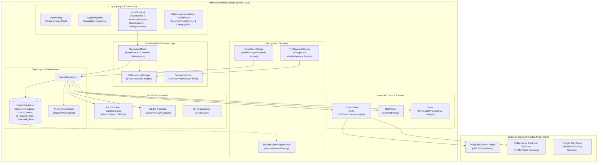

# 00 — Project Overview

> **Last verified commit:** `aaac96970daf81cd5d75cf5fa56dfebf2ecb6b48`  
> **Analysis Date:** 2026-08-25  
> **Application Package:** `uk.sume.streamfolio`  
> **Target Platform:** Android (API 26+ / Android 8.0 Oreo to Android 16 Preview)

---

## 1. Executive Summary & Product Purpose

**StreamFolio** is a modern, privacy-focused, zero-telemetry RSS and Atom news reader built natively for Android using Jetpack Compose and Material 3. The application is engineered to eliminate noise, invasive advertisements, cloud tracking, and algorithm-driven feed manipulation common in commercial news aggregators.

### Core Problems Solved

1. **Information Fragmentation & Algorithmic Feeds:** Aggregates multi-region curated feeds alongside custom user subscriptions without opaque timeline algorithms.
2. **Privacy & Data Exploitation:** Implements a strict **100% on-device architecture** — no telemetry, no tracking SDKs, no external backend servers, and zero cloud accounts required.
3. **Offline Inaccessibility:** Local SQLite caching via Room ensures articles, full-text extractions, and offline AI summaries remain accessible during network dropouts.
4. **On-Device Intelligence:** Integrates Gemini Nano (via Google ML Kit GenAI Summarization / AICore) and ML Kit Translation to perform summarization and translation on-device without sending article data to external cloud APIs.
5. **Accessibility & Eyes-Free Consumption:** Provides a background Text-To-Speech (TTS) engine with Android MediaSession integration, lockscreen media controls, and lyrics-style synchronized text visualizer.

---

## 2. Intended Users & Personas

| Persona | Primary Needs & Use Cases | Key Feature Touchpoints |
| :--- | :--- | :--- |
| **Privacy-Conscious Reader** | Wants news without tracking, user profiling, analytics beacons, or account lock-in. | On-device Room DB, no cloud backend, zero telemetry, local backup/export. |
| **Global News Consumer** | Reads news across multiple regions and languages. | Multi-region curated feeds (14 countries), on-device ML Kit translation. |
| **Commuter / Multitasker** | Consumes long-form news while driving, exercising, or commuting. | Background TTS playback, MediaSession lockscreen controls, sleep timer, playlist queue. |
| **Power RSS User** | Manages extensive custom feed lists and categories. | OPML import/export, custom feed management, tag filtering, customizable swipe gestures. |

---

## 3. Key Features

- **Curated Multi-Region Feeds:** Out-of-the-box verified RSS/Atom feeds across 14 regions (`US`, `GB`, `SG`, `IN`, `CA`, `AU`, `FR`, `DE`, `HK`, `KR`, `JP`, `BR`, `ZA`, `AE`) and 8 standard news categories.
- **Custom Feed & OPML Management:** Add custom RSS/Atom feeds by URL; bulk import and export feeds via OPML 2.0.
- **Intelligent Story Grouping:** Deduplicates and groups related coverage from multiple publishers into collapsible primary/secondary clusters.
- **On-Device GenAI Summarization:** Generates bulleted key takeaways via Gemini Nano (AICore) with intelligent lead/tail truncation and safety filtering.
- **Offline Translation & Language Identification:** Automatic language identification and translation powered by ML Kit NLP models.
- **Full Reader Mode & Article Pre-Scraping:** Background extraction of clean article bodies with typography customization (sans-serif/serif, font size, line spacing).
- **Background Media Playback & TTS:** Android `MediaSessionCompat` and `FOREGROUND_SERVICE_MEDIA_PLAYBACK` service supporting lockscreen controls, notification transport, variable speech rates (0.5x–3.0x), and paragraph-by-paragraph synchronized highlighting.
- **Custom Bookmark Collections:** Organize saved articles into custom collections with grid/list view toggles.
- **Home Screen Widget:** Android AppWidget supporting glassmorphic styling, category/feed filters, article counts, and tap-to-open routing.
- **Periodic Background Sync:** WorkManager periodic worker (`NewsSyncWorker`, default 6-hour interval) keeping cached feeds fresh.
- **Robust Backup & Restore:** JSON-based state backup capturing preferences, bookmarks, custom lists, and RSS configurations.

---

## 4. System Boundaries & Technology Stack



### Technology Specification

| Domain | Technology / Library | Version | Code Reference |
| :--- | :--- | :--- | :--- |
| **Language** | Kotlin | `2.0.21` | [libs.versions.toml](file:///d:/News/gradle/libs.versions.toml#L3) |
| **Android Gradle Plugin** | AGP | `8.13.2` | [libs.versions.toml](file:///d:/News/gradle/libs.versions.toml#L2) |
| **SDK Levels** | Compile: 36, Target: 36, Min: 26 | Android 8.0+ | [app/build.gradle.kts](file:///d:/News/app/build.gradle.kts#L17-L22) |
| **UI Framework** | Jetpack Compose BOM | `2025.05.00` | [libs.versions.toml](file:///d:/News/gradle/libs.versions.toml#L10) |
| **Design System** | Material Design 3 | Compose M3 | [libs.versions.toml](file:///d:/News/gradle/libs.versions.toml#L35) |
| **Local Database** | AndroidX Room | `2.6.1` (KAPT) | [libs.versions.toml](file:///d:/News/gradle/libs.versions.toml#L11) |
| **HTTP Client** | Square OkHttp | `4.12.0` | [libs.versions.toml](file:///d:/News/gradle/libs.versions.toml#L15) |
| **HTML Parser** | Jsoup | `1.18.1` | [libs.versions.toml](file:///d:/News/gradle/libs.versions.toml#L14) |
| **Image Loading** | Coil Compose & GIF | `2.7.0` | [libs.versions.toml](file:///d:/News/gradle/libs.versions.toml#L13) |
| **Background Sync** | AndroidX WorkManager | `2.9.1` | [app/build.gradle.kts](file:///d:/News/app/build.gradle.kts#L84) |
| **Media & Audio** | AndroidX Media | `1.7.0` | [libs.versions.toml](file:///d:/News/gradle/libs.versions.toml#L16) |
| **On-Device GenAI** | ML Kit GenAI Summarization | `1.0.0-beta1` | [app/build.gradle.kts](file:///d:/News/app/build.gradle.kts#L79) |
| **Translation** | ML Kit Translate & LangID | `17.0.3` / `17.0.6` | [libs.versions.toml](file:///d:/News/gradle/libs.versions.toml#L17-L18) |

---

## 5. Repository Layout

```
d:/News/
├── app/                                # Main Android application module
│   ├── schemas/                        # Room schema JSON exports for schema migration validation
│   │   └── uk.sume.streamfolio.data.local.AppDatabase/
│   │       ├── 5.json                  # Schema v5
│   │       ├── 6.json                  # Schema v6 (TTS playlist state)
│   │       ├── 7.json                  # Schema v7 (Article grouping)
│   │       └── 8.json                  # Schema v8 (Custom bookmark collections)
│   ├── src/
│   │   ├── main/
│   │   │   ├── AndroidManifest.xml     # App manifest, permissions, exported components
│   │   │   ├── java/uk/sume/streamfolio/
│   │   │   │   ├── MainActivity.kt     # Single Activity host, deep link router, WorkManager setup
│   │   │   │   ├── StreamFolioWidgetProvider.kt # AppWidget update broadcast receiver
│   │   │   │   ├── StreamFolioWidgetService.kt  # AppWidget RemoteViewsService factory
│   │   │   │   ├── WidgetConfigureActivity.kt   # Configuration activity for AppWidget
│   │   │   │   ├── data/
│   │   │   │   │   ├── local/          # Room DB, DAOs, Migrations, SharedPreferences helper
│   │   │   │   │   ├── model/          # Data entities (Article, BookmarkList, CustomFeed, etc.)
│   │   │   │   │   └── network/        # OkHttp, RSS parser, SSRF interceptor, AI helpers, Curated feeds
│   │   │   │   ├── playback/           # TTS Audio Manager, MediaSession foreground service
│   │   │   │   ├── ui/
│   │   │   │   │   ├── components/     # Reusable Compose UI components & design system tokens
│   │   │   │   │   ├── navigation/     # NavRoutes, AppNavigation, shared element transition host
│   │   │   │   │   ├── screens/        # Top-level screen composables (Home, Detail, Search, Bookmarks)
│   │   │   │   │   │   └── settings/   # Modular sub-settings screens (Main, Feeds, AI, Backup, etc.)
│   │   │   │   │   ├── theme/          # Compose Color, Type, Theme, Dynamic Color palette
│   │   │   │   │   └── viewmodel/      # NewsViewModel state orchestrator
│   │   │   │   ├── util/               # BackupHelper, NetworkMonitor, OpmlHelper, UrlSecurityValidator
│   │   │   │   └── worker/             # NewsSyncWorker (WorkManager periodic task)
│   │   │   └── res/                    # Drawables, layouts, mipmaps, strings, xml configs
│   │   ├── test/                       # Unit tests (BackupHelperTest, DefaultFeedsTest, etc.)
│   │   └── androidTest/                # Instrumented Android UI tests
│   ├── build.gradle.kts                # Application module build configuration
│   └── proguard-rules.pro              # R8 minification and keep rules
├── baselineprofile/                    # com.android.test module: generates app/src/main/generated/baselineProfiles/baseline-prof.txt
├── design_system/                      # Brand assets, React/HTML UI kit, CSS design tokens
├── docs/                               # Comprehensive project documentation suite
├── gradle/                             # Gradle wrapper files & version catalog (libs.versions.toml)
├── landing/                            # Public marketing web pages (index, privacy, terms, changelog)
├── sample_xml/                         # Sample RSS, Atom, and OPML test payloads
├── build.gradle.kts                    # Root project build configuration
├── settings.gradle.kts                 # Root project module definitions
├── update-version.ps1                  # PowerShell build script to bump version code & name
├── CLAUDE.md                           # AI pair programming guidelines and rules
└── README.md                           # Project root documentation entry point
```

---

## 6. Project Status, Assumptions & Known Gaps

### Current Status
- **Release Version:** `1.3.1` (versionCode `22`).
- **Production Status:** Distributed via Google Play Store (`uk.sume.streamfolio`).
- **Core Architecture:** Clean MVVM with Room SQLite persistence, Jetpack Compose UI, and background playback.

### Key Assumptions
1. **Host Connectivity:** Android device will periodically have internet access to fetch RSS XML feeds over HTTPS.
2. **On-Device Hardware:** Gemini Nano features require supported hardware (Pixel 8+, Samsung Galaxy S24+) with AICore installed. Gracefully falls back to standard text extraction when unsupported.
3. **Storage:** Local database size is bounded by automatic pruning rules (`pruneOldArticles` retains bookmarked articles permanently while expiring unbookmarked articles).

### Known Gaps & Items Requiring Confirmation
- **CI/CD Workflows:** *Unknown / Requires Confirmation* — No `.github/workflows` or automated cloud build pipeline configuration exists in the repository. Builds and releases are currently executed manually via `./gradlew` and `update-version.ps1`.
- **Dependency Injection:** Dependencies (`NewsRepository`, `PreferencesHelper`) are instantiated directly or via Singletons rather than Hilt/Koin (documented in [14-decisions-and-known-limitations.md](file:///d:/News/docs/14-decisions-and-known-limitations.md)).
- **Monolithic ViewModel:** `NewsViewModel.kt` coordinates multiple domains (Reader, Settings, Audio, Feeds) in a single class (~1,332 lines).
