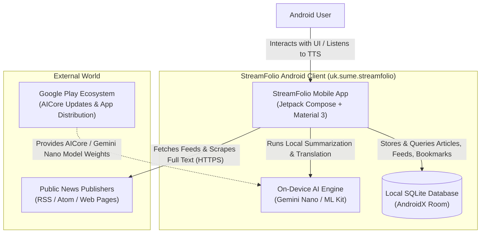
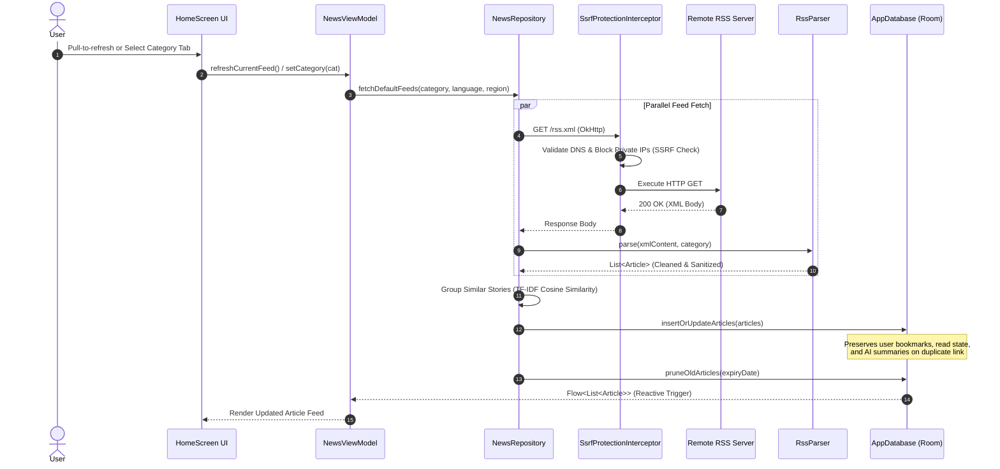
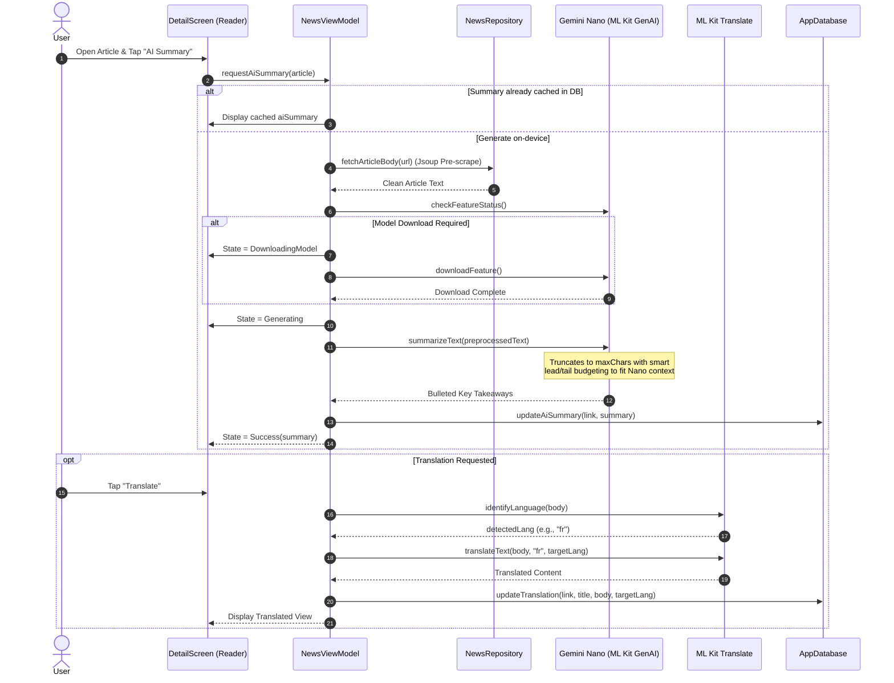
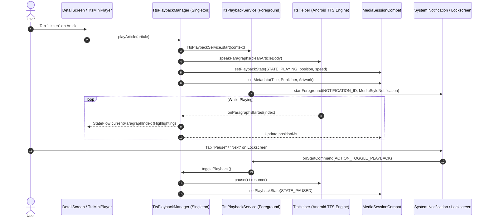

# 01 — Architecture

> **Last verified commit:** `aaac96970daf81cd5d75cf5fa56dfebf2ecb6b48`  
> **Analysis Date:** 2026-08-25  
> **Architecture Style:** Unidirectional Data Flow (UDF) / MVVM with Room Persistence & Foreground Audio Services

---

## 1. System Architecture Context (C4 Context Diagram)

StreamFolio operates as an autonomous, self-contained mobile client. It contains **no central application backend server**; the device communicates directly with third-party RSS publishers, runs all AI inference locally via on-device ML runtimes (Gemini Nano via AICore, ML Kit Translation), and stores all data in a local SQLite database via AndroidX Room.

---

## 2. Container & Component Architecture

```mermaid
graph TB
    subgraph "StreamFolio Android App Container"
        subgraph "UI Layer (Presentation)"
            MainActivity["MainActivity<br/>([MainActivity.kt](file:///d:/News/app/src/main/java/uk/sume/streamfolio/MainActivity.kt))"]
            AppNavigation["AppNavigation<br/>([NavRoutes.kt](file:///d:/News/app/src/main/java/uk/sume/streamfolio/ui/navigation/NavRoutes.kt))"]
            
            subgraph "Composable Screens"
                HomeScreen["HomeScreen<br/>([HomeScreen.kt](file:///d:/News/app/src/main/java/uk/sume/streamfolio/ui/screens/HomeScreen.kt))"]
                DetailScreen["DetailScreen<br/>([DetailScreen.kt](file:///d:/News/app/src/main/java/uk/sume/streamfolio/ui/screens/DetailScreen.kt))"]
                SearchScreen["SearchScreen<br/>([SearchScreen.kt](file:///d:/News/app/src/main/java/uk/sume/streamfolio/ui/screens/SearchScreen.kt))"]
                BookmarkScreen["BookmarkScreen<br/>([BookmarkScreen.kt](file:///d:/News/app/src/main/java/uk/sume/streamfolio/ui/screens/BookmarkScreen.kt))"]
                SettingsScreens["Settings Sub-Screens<br/>([ui/screens/settings/](file:///d:/News/app/src/main/java/uk/sume/streamfolio/ui/screens/settings/))"]
            end
            
            subgraph "Shared UI Components"
                TtsMiniPlayerBar["TtsMiniPlayer & LyricsVisualizer<br/>([TtsMiniPlayer.kt](file:///d:/News/app/src/main/java/uk/sume/streamfolio/ui/components/TtsMiniPlayer.kt))"]
                GlassNavBar["GlassmorphicNavBar<br/>([GlassmorphicNavBar.kt](file:///d:/News/app/src/main/java/uk/sume/streamfolio/ui/components/GlassmorphicNavBar.kt))"]
                PublisherAvatarComp["PublisherAvatar<br/>([PublisherAvatar.kt](file:///d:/News/app/src/main/java/uk/sume/streamfolio/ui/components/PublisherAvatar.kt))"]
            end
        end

        subgraph "State & Domain Layer"
            NewsVM["NewsViewModel<br/>([NewsViewModel.kt](file:///d:/News/app/src/main/java/uk/sume/streamfolio/ui/viewmodel/NewsViewModel.kt))"]
            TtsManager["TtsPlaybackManager (Singleton)<br/>([TtsPlaybackManager.kt](file:///d:/News/app/src/main/java/uk/sume/streamfolio/playback/TtsPlaybackManager.kt))"]
            TtsHelperComp["TtsHelper (Android TTS Wrapper)<br/>([TtsHelper.kt](file:///d:/News/app/src/main/java/uk/sume/streamfolio/ui/components/TtsHelper.kt))"]
        end

        subgraph "Background & OS Services"
            TtsService["TtsPlaybackService<br/>([TtsPlaybackService.kt](file:///d:/News/app/src/main/java/uk/sume/streamfolio/playback/TtsPlaybackService.kt))"]
            SyncWorker["NewsSyncWorker<br/>([NewsSyncWorker.kt](file:///d:/News/app/src/main/java/uk/sume/streamfolio/worker/NewsSyncWorker.kt))"]
            WidgetProvider["StreamFolioWidgetProvider<br/>([StreamFolioWidgetProvider.kt](file:///d:/News/app/src/main/java/uk/sume/streamfolio/StreamFolioWidgetProvider.kt))"]
        end

        subgraph "Data & Infrastructure Layer"
            Repository["NewsRepository<br/>([NewsRepository.kt](file:///d:/News/app/src/main/java/uk/sume/streamfolio/data/network/NewsRepository.kt))"]
            Prefs["PreferencesHelper<br/>([PreferencesHelper.kt](file:///d:/News/app/src/main/java/uk/sume/streamfolio/data/local/PreferencesHelper.kt))"]
            Database[("AppDatabase (Room v8)<br/>([AppDatabase.kt](file:///d:/News/app/src/main/java/uk/sume/streamfolio/data/local/AppDatabase.kt))")]
            
            subgraph "Parsers & Network Engine"
                OkHttpClient["OkHttpClient + SsrfProtectionInterceptor<br/>([SsrfProtectionInterceptor.kt](file:///d:/News/app/src/main/java/uk/sume/streamfolio/data/network/SsrfProtectionInterceptor.kt))"]
                RssXmlParser["RssParser (XmlPullParser)<br/>([RssParser.kt](file:///d:/News/app/src/main/java/uk/sume/streamfolio/data/network/RssParser.kt))"]
                JsoupCleaner["Jsoup HTML Body Scraper"]
            end

            subgraph "Local On-Device AI Engine"
                GeminiNano["AiSummaryHelper (Gemini Nano)<br/>([AiSummaryHelper.kt](file:///d:/News/app/src/main/java/uk/sume/streamfolio/data/network/AiSummaryHelper.kt))"]
                MlKitTrans["AiTranslateHelper (ML Kit)<br/>([AiTranslateHelper.kt](file:///d:/News/app/src/main/java/uk/sume/streamfolio/data/network/AiTranslateHelper.kt))"]
            end
        end
    end

    MainActivity --> AppNavigation
    AppNavigation --> HomeScreen & DetailScreen & SearchScreen & BookmarkScreen & SettingsScreens
    HomeScreen & DetailScreen & SearchScreen & BookmarkScreen & SettingsScreens --> NewsVM
    NewsVM --> Repository
    NewsVM --> TtsManager
    TtsManager --> TtsHelperComp
    TtsService --> TtsManager
    SyncWorker --> Repository
    WidgetProvider --> Database
    Repository --> Database & Prefs
    Repository --> OkHttpClient
    Repository --> RssXmlParser & JsoupCleaner
    Repository --> GeminiNano & MlKitTrans
```

---

## 3. Request Lifecycle & Major User Flows

### Flow 1: RSS Feed Ingestion, Deduplication & Storage

---

### Flow 2: On-Device GenAI Summarization & Offline Translation

---

### Flow 3: Text-To-Speech Background Audio & MediaSession

---

## 4. Architectural Patterns & Decisions

### 1. Unidirectional Data Flow (UDF) & Reactive State
- All screens observe immutable `StateFlow` primitives exposed by [NewsViewModel.kt](file:///d:/News/app/src/main/java/uk/sume/streamfolio/ui/viewmodel/NewsViewModel.kt).
- User interactions dispatch single-directional events into ViewModel methods (`refreshCurrentFeed()`, `toggleBookmark()`, `searchArticles()`).
- Database mutations in Room trigger reactive `Flow<List<Article>>` emissions that update the UI without manual state reloading.

### 2. Defensive Network & SSRF Mitigation
- Network requests executed via [NewsRepository.kt](file:///d:/News/app/src/main/java/uk/sume/streamfolio/data/network/NewsRepository.kt) pass through [SsrfProtectionInterceptor.kt](file:///d:/News/app/src/main/java/uk/sume/streamfolio/data/network/SsrfProtectionInterceptor.kt).
- Resolves host DNS prior to HTTP transport and blocks loopback (`127.0.0.1`), link-local (`169.254.169.254`), private RFC1918 subnets (`10.0.0.0/8`, `172.16.0.0/12`, `192.168.0.0/16`), carrier-grade NAT, and cloud metadata hostnames.

### 3. Story Grouping & Natural Language Clustering
- Ingested articles within each category are clustered using text tokenization, stop-word removal, and cosine similarity heuristics.
- Similar stories from distinct news outlets are merged into `ArticleGroup` instances, presenting a single primary hero card with expandable secondary alternative coverage links.

### 4. Background Sync Architecture
- [NewsSyncWorker.kt](file:///d:/News/app/src/main/java/uk/sume/streamfolio/worker/NewsSyncWorker.kt) runs via AndroidX WorkManager on a 6-hour periodic schedule with `NetworkType.CONNECTED` constraints.
- Iterates over user-selected categories, fetching feeds in the background and populating Room cache without waking UI components.

---

## 5. Architectural Quality Matrix

| Quality Attribute | Architectural Solution | Source Reference |
| :--- | :--- | :--- |
| **Privacy** | 100% on-device processing; zero cloud analytics; on-device Gemini Nano & ML Kit. | [privacy.html](file:///d:/News/landing/privacy.html) |
| **Fault Tolerance** | Offline Room caching; Jsoup fallback scraping; graceful degradation if AICore is missing. | [AiHelperFactory.kt](file:///d:/News/app/src/main/java/uk/sume/streamfolio/data/network/AiHelperFactory.kt#L61-L81) |
| **Data Integrity** | Explicit Room migrations (v5 to v8); destructive migrations restricted to legacy v1-4. | [Migrations.kt](file:///d:/News/app/src/main/java/uk/sume/streamfolio/data/local/Migrations.kt) |
| **Security** | SSRF blocking interceptor; cleartext domain whitelist; input length clamping on backup restore. | [UrlSecurityValidator.kt](file:///d:/News/app/src/main/java/uk/sume/streamfolio/util/UrlSecurityValidator.kt) |
| **User Experience** | Glassmorphic design system; shared element transitions; lockscreen media controls. | [NavRoutes.kt](file:///d:/News/app/src/main/java/uk/sume/streamfolio/ui/navigation/NavRoutes.kt#L79-L86) |
