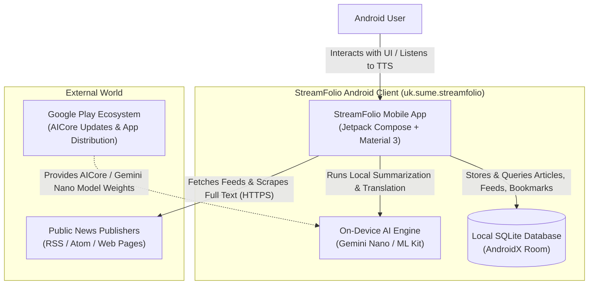
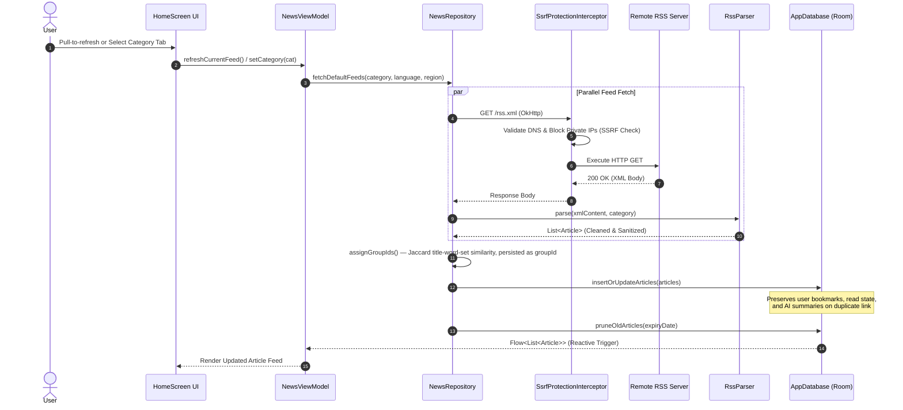
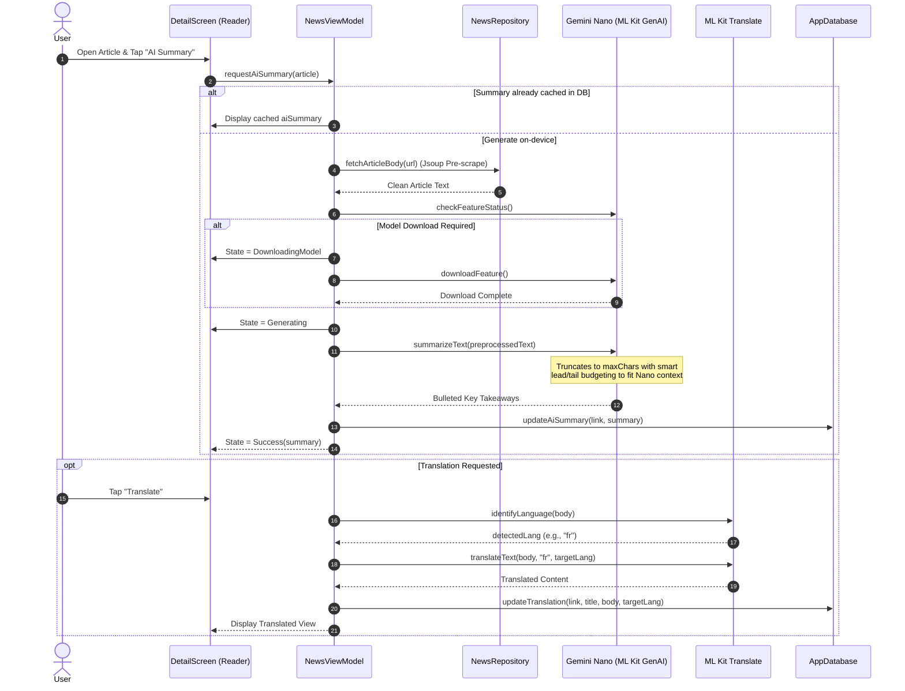
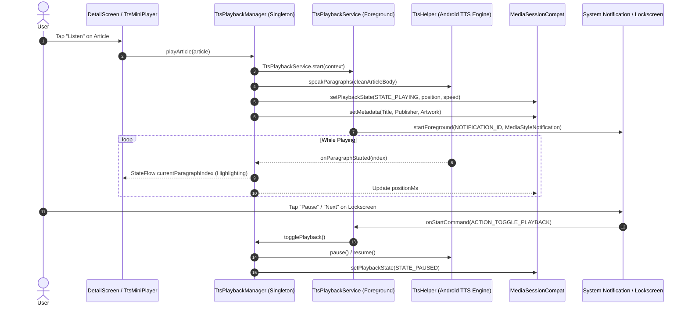
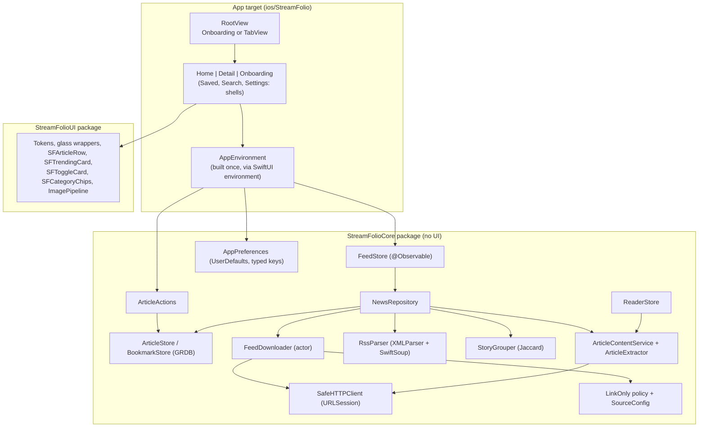

# 01 — Architecture

> **Last verified commit:** `aaac96970daf81cd5d75cf5fa56dfebf2ecb6b48`  
> **Analysis Date:** 2026-08-25  
> **Architecture Style:** Unidirectional Data Flow (UDF) / MVVM with Room Persistence & Foreground Audio Services

---

## 1. System Architecture Context (C4 Context Diagram)

StreamFolio operates as an autonomous, self-contained mobile client. It contains **no central application backend server**; the device communicates directly with third-party RSS publishers, runs all AI inference locally via on-device ML runtimes (Gemini Nano via AICore, ML Kit Translation), and stores all data in a local SQLite database via AndroidX Room.

---

## 2. Container & Component Architecture

```mermaid
graph TB
    subgraph "StreamFolio Android App Container"
        subgraph "UI Layer (Presentation)"
            MainActivity["MainActivity<br/>([MainActivity.kt](file:///d:/News/app/src/main/java/uk/sume/streamfolio/MainActivity.kt))"]
            AppNavigation["AppNavigation<br/>([NavRoutes.kt](file:///d:/News/app/src/main/java/uk/sume/streamfolio/ui/navigation/NavRoutes.kt))"]
            
            subgraph "Composable Screens"
                HomeScreen["HomeScreen<br/>([HomeScreen.kt](file:///d:/News/app/src/main/java/uk/sume/streamfolio/ui/screens/HomeScreen.kt))"]
                DetailScreen["DetailScreen<br/>([DetailScreen.kt](file:///d:/News/app/src/main/java/uk/sume/streamfolio/ui/screens/DetailScreen.kt))"]
                SearchScreen["SearchScreen<br/>([SearchScreen.kt](file:///d:/News/app/src/main/java/uk/sume/streamfolio/ui/screens/SearchScreen.kt))"]
                BookmarkScreen["BookmarkScreen<br/>([BookmarkScreen.kt](file:///d:/News/app/src/main/java/uk/sume/streamfolio/ui/screens/BookmarkScreen.kt))"]
                SettingsScreens["Settings Sub-Screens<br/>([ui/screens/settings/](file:///d:/News/app/src/main/java/uk/sume/streamfolio/ui/screens/settings/))"]
            end
            
            subgraph "Shared UI Components"
                TtsMiniPlayerBar["TtsMiniPlayer & LyricsVisualizer<br/>([TtsMiniPlayer.kt](file:///d:/News/app/src/main/java/uk/sume/streamfolio/ui/components/TtsMiniPlayer.kt))"]
                GlassNavBar["GlassmorphicNavBar<br/>([GlassmorphicNavBar.kt](file:///d:/News/app/src/main/java/uk/sume/streamfolio/ui/components/GlassmorphicNavBar.kt))"]
                PublisherAvatarComp["PublisherAvatar<br/>([PublisherAvatar.kt](file:///d:/News/app/src/main/java/uk/sume/streamfolio/ui/components/PublisherAvatar.kt))"]
            end
        end

        subgraph "State & Domain Layer"
            NewsVM["NewsViewModel<br/>([NewsViewModel.kt](file:///d:/News/app/src/main/java/uk/sume/streamfolio/ui/viewmodel/NewsViewModel.kt))"]
            TtsManager["TtsPlaybackManager (Singleton)<br/>([TtsPlaybackManager.kt](file:///d:/News/app/src/main/java/uk/sume/streamfolio/playback/TtsPlaybackManager.kt))"]
            TtsHelperComp["TtsHelper (Android TTS Wrapper)<br/>([TtsHelper.kt](file:///d:/News/app/src/main/java/uk/sume/streamfolio/ui/components/TtsHelper.kt))"]
        end

        subgraph "Background & OS Services"
            TtsService["TtsPlaybackService<br/>([TtsPlaybackService.kt](file:///d:/News/app/src/main/java/uk/sume/streamfolio/playback/TtsPlaybackService.kt))"]
            SyncWorker["NewsSyncWorker<br/>([NewsSyncWorker.kt](file:///d:/News/app/src/main/java/uk/sume/streamfolio/worker/NewsSyncWorker.kt))"]
            WidgetProvider["StreamFolioWidgetProvider<br/>([StreamFolioWidgetProvider.kt](file:///d:/News/app/src/main/java/uk/sume/streamfolio/StreamFolioWidgetProvider.kt))"]
        end

        subgraph "Data & Infrastructure Layer"
            Repository["NewsRepository<br/>([NewsRepository.kt](file:///d:/News/app/src/main/java/uk/sume/streamfolio/data/network/NewsRepository.kt))"]
            Prefs["PreferencesHelper<br/>([PreferencesHelper.kt](file:///d:/News/app/src/main/java/uk/sume/streamfolio/data/local/PreferencesHelper.kt))"]
            Database[("AppDatabase (Room v8)<br/>([AppDatabase.kt](file:///d:/News/app/src/main/java/uk/sume/streamfolio/data/local/AppDatabase.kt))")]
            
            subgraph "Parsers & Network Engine"
                OkHttpClient["OkHttpClient + SsrfProtectionInterceptor<br/>([SsrfProtectionInterceptor.kt](file:///d:/News/app/src/main/java/uk/sume/streamfolio/data/network/SsrfProtectionInterceptor.kt))"]
                RssXmlParser["RssParser (XmlPullParser)<br/>([RssParser.kt](file:///d:/News/app/src/main/java/uk/sume/streamfolio/data/network/RssParser.kt))"]
                JsoupCleaner["Jsoup HTML Body Scraper"]
            end

            subgraph "Local On-Device AI Engine"
                GeminiNano["AiSummaryHelper (Gemini Nano)<br/>([AiSummaryHelper.kt](file:///d:/News/app/src/main/java/uk/sume/streamfolio/data/network/AiSummaryHelper.kt))"]
                MlKitTrans["AiTranslateHelper (ML Kit)<br/>([AiTranslateHelper.kt](file:///d:/News/app/src/main/java/uk/sume/streamfolio/data/network/AiTranslateHelper.kt))"]
            end
        end
    end

    MainActivity --> AppNavigation
    AppNavigation --> HomeScreen & DetailScreen & SearchScreen & BookmarkScreen & SettingsScreens
    HomeScreen & DetailScreen & SearchScreen & BookmarkScreen & SettingsScreens --> NewsVM
    NewsVM --> Repository
    NewsVM --> TtsManager
    TtsManager --> TtsHelperComp
    TtsService --> TtsManager
    SyncWorker --> Repository
    WidgetProvider --> Database
    Repository --> Database & Prefs
    Repository --> OkHttpClient
    Repository --> RssXmlParser & JsoupCleaner
    Repository --> GeminiNano & MlKitTrans
```

---

## 3. Request Lifecycle & Major User Flows

### Flow 1: RSS Feed Ingestion, Deduplication & Storage

After the initial batched insert above, `NewsRepository` also fans out background enrichment for the freshly-fetched articles — up to ~40 concurrent thumbnail resolutions, 30 Straits Times thumbnail retries, 10 article-body pre-scrapes, and 20 AI tagging calls (`triggerThumbnailResolution`/`triggerStraitsTimesThumbnailRetry`/`triggerArticleBodyPreScrape`/`triggerArticleTagging` in [NewsRepository.kt](file:///d:/News/app/src/main/java/uk/sume/streamfolio/data/network/NewsRepository.kt#L320-L420)). Each of those writes its own row individually as its network call completes, so the DB can emit dozens of Flow re-queries over the following several seconds — not one clean update. `NewsViewModel.categoryArticlesState` ([NewsViewModel.kt](file:///d:/News/app/src/main/java/uk/sume/streamfolio/ui/viewmodel/NewsViewModel.kt#L207-L245)) applies `.debounce(300)` to that Flow specifically to collapse this trickle into far fewer `groupSimilarArticles` recomputations / `LazyColumn` recompositions, since without it this showed up as scroll stutter for several seconds after every refresh as enrichment results landed one at a time.

**Link-only sources.** Articles from hosts in `LinkOnlySources` (currently Joho no Todai) are excluded from all of that enrichment: no thumbnail resolution, no body pre-scrape, no AI summarization during tagging (keyword tags only). Their feeds are fetched through `fetchLinkOnlyFeedXml()` with a per-device 30-minute limit and are gated by a static remote source list (`SourceConfig`), which also purges them from the device on withdrawal. See [ADR-006](file:///d:/News/docs/14-decisions-and-known-limitations.md) and [04](file:///d:/News/docs/04-api-documentation.md).

**Similar Articles Lookup (Home feed vs. Detail screen).** `assignGroupIds()` (step 7 above) is the *only* place similarity is actually computed — it persists the result as each article's `groupId`, indexed via `MIGRATION_8_9` (see [05-data-model-and-database.md](file:///d:/News/docs/05-data-model-and-database.md)). `NewsViewModel.groupSimilarArticles()` builds the Home feed's "Also covered by" grouping from that `groupId` with a cheap `groupBy` whenever any article in the list already has one. `DetailScreen`'s own "also covered by" panel used to ignore all of this and re-run a *live* Jaccard scan against every article in the database from scratch on every article open (`NewsViewModel.loadArticleBody()`), landing in the same frame window as the shared-element open animation — duplicating work already done at ingest time. `NewsViewModel.loadSimilarArticles(url)` now looks the group up with a single indexed `WHERE groupId = ...` query instead, falling back to the live scan only for articles that predate `assignGroupIds` and were never given a `groupId` at all. It's called from `DetailScreen.kt`'s own `LaunchedEffect(url)`, gated on `animatedVisibilityScope.transition.isRunning` going false, so it only starts once the open-article animation has actually finished, and is genuinely cancelled (not just superseded) if the user navigates away before it completes.

---

### Flow 2: On-Device GenAI Summarization & Offline Translation

---

### Flow 3: Text-To-Speech Background Audio & MediaSession

---

## 4. Architectural Patterns & Decisions

### 1. Unidirectional Data Flow (UDF) & Reactive State
- All screens observe immutable `StateFlow` primitives exposed by [NewsViewModel.kt](file:///d:/News/app/src/main/java/uk/sume/streamfolio/ui/viewmodel/NewsViewModel.kt).
- User interactions dispatch single-directional events into ViewModel methods (`refreshCurrentFeed()`, `toggleBookmark()`, `searchArticles()`).
- Database mutations in Room trigger reactive `Flow<List<Article>>` emissions that update the UI without manual state reloading.

### 2. Defensive Network & SSRF Mitigation
- Network requests executed via [NewsRepository.kt](file:///d:/News/app/src/main/java/uk/sume/streamfolio/data/network/NewsRepository.kt) pass through [SsrfProtectionInterceptor.kt](file:///d:/News/app/src/main/java/uk/sume/streamfolio/data/network/SsrfProtectionInterceptor.kt).
- Resolves host DNS prior to HTTP transport and blocks loopback (`127.0.0.1`), link-local (`169.254.169.254`), private RFC1918 subnets (`10.0.0.0/8`, `172.16.0.0/12`, `192.168.0.0/16`), carrier-grade NAT, and cloud metadata hostnames.

### 3. Story Grouping & Natural Language Clustering
- Ingested articles within each category are clustered using text tokenization, stop-word removal, and cosine similarity heuristics.
- Similar stories from distinct news outlets are merged into `ArticleGroup` instances, presenting a single primary hero card with expandable secondary alternative coverage links.

### 4. Background Sync Architecture
- [NewsSyncWorker.kt](file:///d:/News/app/src/main/java/uk/sume/streamfolio/worker/NewsSyncWorker.kt) runs via AndroidX WorkManager on a 6-hour periodic schedule with `NetworkType.CONNECTED` constraints.
- Iterates over user-selected categories, fetching feeds in the background and populating Room cache without waking UI components.

---

## 5. Architectural Quality Matrix

| Quality Attribute | Architectural Solution | Source Reference |
| :--- | :--- | :--- |
| **Privacy** | 100% on-device processing; zero cloud analytics; on-device Gemini Nano & ML Kit. | [privacy.html](file:///d:/News/landing/privacy.html) |
| **Fault Tolerance** | Offline Room caching; Jsoup fallback scraping; graceful degradation if AICore is missing. | [AiHelperFactory.kt](file:///d:/News/app/src/main/java/uk/sume/streamfolio/data/network/AiHelperFactory.kt#L61-L81) |
| **Data Integrity** | Explicit Room migrations (v5 to v8); destructive migrations restricted to legacy v1-4. | [Migrations.kt](file:///d:/News/app/src/main/java/uk/sume/streamfolio/data/local/Migrations.kt) |
| **Security** | SSRF blocking interceptor; cleartext domain whitelist; input length clamping on backup restore. | [UrlSecurityValidator.kt](file:///d:/News/app/src/main/java/uk/sume/streamfolio/util/UrlSecurityValidator.kt) |
| **User Experience** | Glassmorphic design system; shared element transitions; lockscreen media controls. | [NavRoutes.kt](file:///d:/News/app/src/main/java/uk/sume/streamfolio/ui/navigation/NavRoutes.kt#L79-L86) |

---

## 6. iOS Architecture (`ios/`, added 2026-10-24)

The iOS app is a separate native SwiftUI client with the same product rules. Android is the specification; differences are listed in [14](14-decisions-and-known-limitations.md).

Flow of a refresh (`FeedStore.refreshNow` → `NewsRepository.refresh` → `refreshDefaultFeeds` / `refreshCustomFeeds`): validate the remote source list, look up curated feeds for the region/category, fetch all feeds in parallel (`FeedDownloader` → `SafeHTTPClient`), parse each (`RssParser`), de-duplicate by link, assign story groups (`StoryGrouper`), upsert preserving user state, prune by retention. The database change is observed (`ValueObservation`) and `FeedStore` republishes grouped stories to the UI. A category is refreshed automatically when selected if it is older than 15 minutes (as on Android).

**Article content:** `ArticleContentService` fetches an article page through the same safe client, `ArticleExtractor` (SwiftSoup) pulls the paragraphs (`article p, main p, …` else every `p`, minus promos/captions, ≥30 characters) and the lead image (`og:image` → `twitter:image` → JSON-LD → first article image; Google-hosted logos rejected; https-only), and `ReaderStore` turns that into what the Reader shows. After a refresh, `NewsRepository` resolves up to 40 missing images and pre-fetches the 10 newest bodies in the background; link-only articles are skipped inside the service.

**Search and Saved:** `SearchService` fetches the active curated feeds (8 in parallel), keeps matches (`SearchMatching`) and caches them under category `SEARCH`; `SearchStore` debounces typing, observes the local results and keeps recents/trending. `BookmarkStore` + `SavedStore`/`CollectionContents` provide collections with counts and previews; `ArticleActions` + `ArticleInteractions` run save/share/read from any list.

**Custom feeds and Home tabs:** `CustomFeedStore` (validated adds/edits, OPML import) feeds `FeedStore`, which merges each custom feed's tab label into the Home tabs with the selected curated categories (`CategoryLayout`, the single definition also used by the Reorder screen). `NewsRepository.refresh(category:customFeeds:)` fetches the custom feeds under that label and then, for a curated category, the curated feeds; `FeedReader` is the one place a feed URL becomes articles (HTTPS-only validation, OPML-as-feed expansion, link-only skipping for search) and is shared by refresh and online search. `ProviderSelection` owns the on/off rules of curated publishers.

**Backup:** `BackupService` writes and restores Android's backup v2 JSON. One table (`BackupPreferences`) maps the backup's key names to the `Preference` registry and drives both export and import, so they cannot drift; values that come from a file are validated by the same `Preference` ranges.

**Not built yet on iOS:** AI tagging/summary, translation (the Settings switches exist and are stored), TTS, widget, background refresh, Google News URL resolution.
