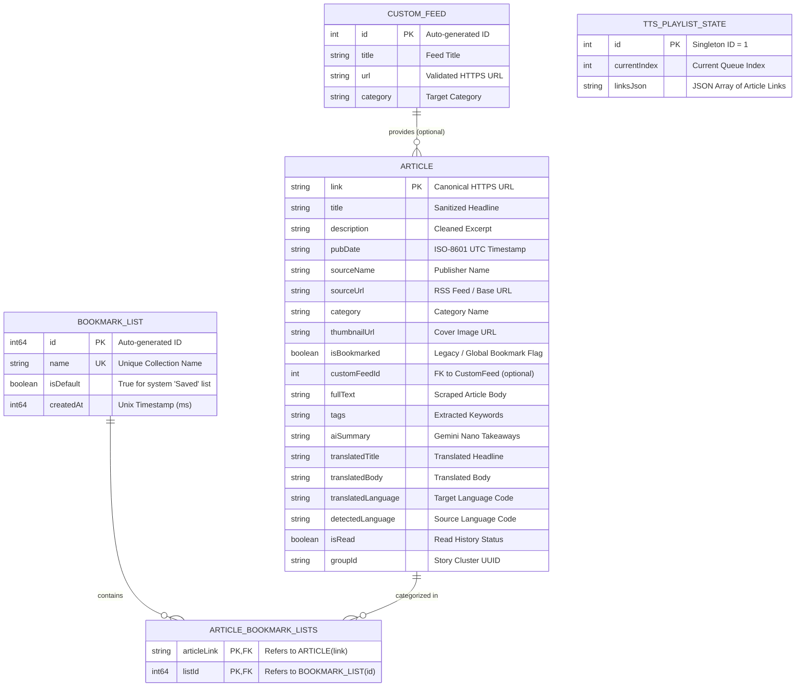

# 05 — Data Model & Database Architecture

> **Last verified commit:** `aaac96970daf81cd5d75cf5fa56dfebf2ecb6b48`  
> **Analysis Date:** 2026-08-25  
> **Database Engine:** SQLite via AndroidX Room `2.6.1`  
> **Database Name:** `news_database`  
> **Current Schema Version:** `8`

---

## 1. Entity-Relationship Diagram (ERD)



---

## 2. Table Specifications & Schema Definitions

### 1. `articles` Table

Defined in [Article.kt](file:///d:/News/app/src/main/java/uk/sume/streamfolio/data/model/Article.kt#L6).

| Column Name | SQLite Type | Nullable | Default | Constraints / Notes |
| :--- | :--- | :--- | :--- | :--- |
| `link` | `TEXT` | **No** | None | **Primary Key**. Canonical article URL. |
| `title` | `TEXT` | **No** | None | HTML-sanitized title string. |
| `description` | `TEXT` | **No** | None | Cleaned snippet or summary. |
| `pubDate` | `TEXT` | **No** | None | Normalized ISO 8601 UTC timestamp. |
| `sourceName` | `TEXT` | **No** | None | Resolved publisher or source name. |
| `sourceUrl` | `TEXT` | **No** | `""` | Origin feed URL or domain. |
| `category` | `TEXT` | **No** | None | Assigned news category. |
| `thumbnailUrl` | `TEXT` | Yes | `NULL` | Resolved cover image URL. |
| `isBookmarked` | `INTEGER` | **No** | `0` | Boolean (0/1) for bookmark state. |
| `customFeedId` | `INTEGER` | Yes | `NULL` | Identifier if fetched from a custom user feed. |
| `fullText` | `TEXT` | Yes | `NULL` | Scraped full article body. |
| `tags` | `TEXT` | Yes | `NULL` | Comma-separated extracted topic tags. |
| `aiSummary` | `TEXT` | Yes | `NULL` | Bulleted Gemini Nano summarization. |
| `translatedTitle` | `TEXT` | Yes | `NULL` | Cached translated title. |
| `translatedBody` | `TEXT` | Yes | `NULL` | Cached translated full text. |
| `translatedLanguage`| `TEXT` | Yes | `NULL` | Target BCP 47 language code. |
| `detectedLanguage` | `TEXT` | Yes | `NULL` | Identified source language code. |
| `isRead` | `INTEGER` | **No** | `0` | Boolean (0/1) for reading history. |
| `groupId` | `TEXT` | Yes | `NULL` | UUID for related story clustering. |

---

### 2. `bookmark_lists` & `article_bookmark_lists` Tables

Defined in [BookmarkList.kt](file:///d:/News/app/src/main/java/uk/sume/streamfolio/data/model/BookmarkList.kt).

- **`bookmark_lists`**:
  - `id`: `INTEGER PRIMARY KEY AUTOINCREMENT NOT NULL`
  - `name`: `TEXT NOT NULL` (Unique Index `index_bookmark_lists_name`)
  - `isDefault`: `INTEGER NOT NULL` (`1` for the default `"Saved"` list, `0` for user collections)
  - `createdAt`: `INTEGER NOT NULL`
- **`article_bookmark_lists`** (Many-to-Many Cross-Reference):
  - `articleLink`: `TEXT NOT NULL` (Index `index_article_bookmark_lists_articleLink`)
  - `listId`: `INTEGER NOT NULL` (Index `index_article_bookmark_lists_listId`)
  - `PRIMARY KEY (articleLink, listId)`

---

### 3. `custom_feeds` Table

Defined in [CustomFeed.kt](file:///d:/News/app/src/main/java/uk/sume/streamfolio/data/model/CustomFeed.kt).

- `id`: `INTEGER PRIMARY KEY AUTOINCREMENT NOT NULL`
- `title`: `TEXT NOT NULL`
- `url`: `TEXT NOT NULL` (Validated HTTPS URL)
- `category`: `TEXT NOT NULL`

---

### 4. `tts_playlist_state` Table

Defined in [TtsPlaylistState.kt](file:///d:/News/app/src/main/java/uk/sume/streamfolio/data/model/TtsPlaylistState.kt).

- `id`: `INTEGER PRIMARY KEY NOT NULL` (Always `1` — singleton state row)
- `currentIndex`: `INTEGER NOT NULL`
- `linksJson`: `TEXT NOT NULL` (JSON array of article URLs in active audio queue)

---

## 3. Database Migrations History

Room migrations are configured in [Migrations.kt](file:///d:/News/app/src/main/java/uk/sume/streamfolio/data/local/Migrations.kt) and registered in [AppDatabase.kt](file:///d:/News/app/src/main/java/uk/sume/streamfolio/data/local/AppDatabase.kt#L35-L40):

```kotlin
.addMigrations(*ALL_MIGRATIONS)
.fallbackToDestructiveMigrationFrom(1, 2, 3, 4)
```

| Migration Step | From | To | Structural Changes | Rationale |
| :--- | :--- | :--- | :--- | :--- |
| **`MIGRATION_5_6`** | 5 | 6 | `CREATE TABLE tts_playlist_state` | Persists TTS audio playlist across Android process death. |
| **`MIGRATION_6_7`** | 6 | 7 | `ALTER TABLE articles ADD COLUMN groupId TEXT DEFAULT NULL` | Supports multi-publisher story clustering and deduplication. |
| **`MIGRATION_7_8`** | 7 | 8 | `CREATE TABLE bookmark_lists`, `CREATE TABLE article_bookmark_lists`, seeds default list (`id=1, name='Saved'`), migrates existing bookmarked articles. | Introduces customizable multi-collection bookmark management. |
| **`MIGRATION_8_9`** | 8 | 9 | `CREATE INDEX index_articles_groupId ON articles (groupId)` | Lets `DetailScreen`'s "also covered by" panel look up an article's group with a single indexed row lookup instead of a live similarity scan across the whole table — see below. |

> **Fresh-install gap (fixed):** `MIGRATION_7_8`'s default-list seed only runs for installs that were *upgraded* through schema v7→v8. A fresh install creates the v8 schema directly from the `@Entity` annotations and never executes that migration, so `bookmark_lists` started out with zero rows — `SaveToListBottomSheet` then had no list to show and silently failed to bookmark anything (confirmed on a real device: `bookmark_lists` was empty despite the article having `isBookmarked = 1` articles from before the multi-list feature). [AppDatabase.kt](file:///d:/News/app/src/main/java/uk/sume/streamfolio/data/local/AppDatabase.kt) now adds a `RoomDatabase.Callback.onOpen()` that runs the same `INSERT OR IGNORE ... VALUES (1, 'Saved', 1, ...)` idempotently on every database open (not just `onCreate`), which seeds it for fresh installs and self-heals any existing install already stuck in that empty state.

> **Duplicate similarity computation (fixed):** [NewsRepository.assignGroupIds()](file:///d:/News/app/src/main/java/uk/sume/streamfolio/data/network/NewsRepository.kt#L1040) already computes Jaccard title-similarity and persists the result as each article's `groupId` on every refresh — that's how the Home feed's "Also covered by" grouping (`NewsViewModel.groupSimilarArticles()`'s `groupId`-based fast path) works without ever opening an article. `DetailScreen`'s own "also covered by" panel didn't reuse any of that: `loadArticleBody()` called `getAllArticlesUnlimitedSync()` and re-ran a live Jaccard scan against *every* article in the database from scratch, every time an article was opened, landing squarely in the same frame window as the shared-element open animation. It's fixed now — see the "Similar Articles Lookup" note under [Flow 1](file:///d:/News/docs/01-architecture.md) in `01-architecture.md` for the full before/after.
>
> Note `assignGroupIds()` gives *every* article a `groupId`, even ones with no similar coverage (it falls back to `matchedGroupId = article.link`, a "group of one") — so `groupId IS NULL` only ever means an article predates this feature entirely (or came from a never-grouped path), not "this article has no similar articles." That distinction is what makes the indexed-lookup fast path in `MIGRATION_8_9` safe to rely on for the common case.

---

## 4. Data Lifecycle, Retention & Integrity

1. **Conflict Resolution Strategy:**
   - [ArticleDao.kt](file:///d:/News/app/src/main/java/uk/sume/streamfolio/data/local/ArticleDao.kt#L20-L41) executes a `@Transaction` method `insertOrUpdateArticles()`:
   - If an article link already exists in SQLite, it **preserves** user-specific state (`isBookmarked`, `isRead`, `fullText`, `aiSummary`, `translatedTitle`, `translatedBody`, `detectedLanguage`) while updating headlines or timestamps.
2. **Automated Cache Pruning:**
   - Periodic worker and feed refreshes call `pruneOldArticles(expiryDate)`:
   - Deletes unbookmarked articles older than `cacheHistoryDays` (configurable in settings, default ~100 years).
   - Articles marked `isBookmarked = 1` or referenced in `article_bookmark_lists` are **never pruned**.
3. **Transaction Safety:**
   - Bookmark list deletions provide optional migration of associated articles into the default `"Saved"` collection (`reassignListArticles()`).
