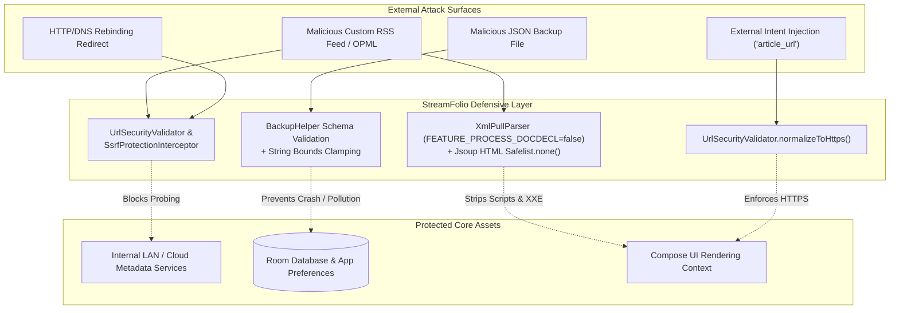

# 06 — Authentication, Authorization & Security Architecture

> **Last verified commit:** `aaac96970daf81cd5d75cf5fa56dfebf2ecb6b48`  
> **Analysis Date:** 2026-08-25  
> **Security Posture:** Zero-Auth / 100% On-Device / Threat Model with Layered Defensive Controls

---

## 1. Identity & Access Control Model

StreamFolio does not implement remote authentication, OAuth2, session cookies, or user accounts. All state (reading history, custom feeds, bookmarks, and preferences) is stored in the application's private sandbox directory (`/data/data/uk.sume.streamfolio/databases/`).

### Access Control Matrix

| Component / Resource | Access Boundary | Authorization Mechanism | Code Reference |
| :--- | :--- | :--- | :--- |
| **Room SQLite DB** | App Private Storage | Linux User ID sandboxing (`Context.MODE_PRIVATE`) | [AppDatabase.kt](file:///d:/News/app/src/main/java/uk/sume/streamfolio/data/local/AppDatabase.kt) |
| **SharedPreferences** | App Private Storage | `Context.MODE_PRIVATE` | [PreferencesHelper.kt](file:///d:/News/app/src/main/java/uk/sume/streamfolio/data/local/PreferencesHelper.kt) |
| **`MainActivity`** | Public (Launcher) | `android.intent.action.MAIN` (Sanitizes extra URLs) | [MainActivity.kt](file:///d:/News/app/src/main/java/uk/sume/streamfolio/MainActivity.kt#L29-L32) |
| **`WidgetConfigureActivity`** | System Launcher | `android.appwidget.action.APPWIDGET_CONFIGURE` | [AndroidManifest.xml](file:///d:/News/app/src/main/AndroidManifest.xml#L33-L39) |
| **`StreamFolioWidgetProvider`** | System AppWidget Manager | `exported="false"` | [AndroidManifest.xml](file:///d:/News/app/src/main/AndroidManifest.xml#L41-L50) |
| **`StreamFolioWidgetService`** | RemoteViews Framework | `exported="false"`, `permission="BIND_REMOTEVIEWS"` | [AndroidManifest.xml](file:///d:/News/app/src/main/AndroidManifest.xml#L52-L56) |
| **`TtsPlaybackService`** | Internal Explicit Intents | `exported="false"`, `foregroundServiceType="mediaPlayback"` | [AndroidManifest.xml](file:///d:/News/app/src/main/AndroidManifest.xml#L58-L62) |
| **`FileProvider`** | Internal Cache Sharing | `exported="false"`, `grantUriPermissions="true"` | [AndroidManifest.xml](file:///d:/News/app/src/main/AndroidManifest.xml#L64-L71) |

---

## 2. Threat Modeling & Defensive Controls



---

## 3. Implemented Security Controls

### 1. SSRF & DNS-Rebinding Prevention
- **Issue:** Users can input arbitrary RSS feed URLs or import OPML files containing internal IP addresses (e.g. `http://169.254.169.254/` cloud metadata or `http://192.168.1.1/` router endpoints).
- **Defense:**
  - [UrlSecurityValidator.kt](file:///d:/News/app/src/main/java/uk/sume/streamfolio/util/UrlSecurityValidator.kt#L100-L123) rejects reserved IPv4 blocks (`127.0.0.0/8`, `10.0.0.0/8`, `172.16.0.0/12`, `192.168.0.0/16`, `169.254.0.0/16`, `100.64.0.0/10`, `192.0.0.0/24`, `192.0.2.0/24`, `198.18.0.0/15`, `198.51.100.0/24`, `203.0.113.0/24`, `240.0.0.0/4`).
  - Blocks well-known cloud metadata hostnames (`metadata.google.internal`, `metadata.azure.internal`, `metadata.aws.internal`, `instance-data`).
  - [SsrfProtectionInterceptor.kt](file:///d:/News/app/src/main/java/uk/sume/streamfolio/data/network/SsrfProtectionInterceptor.kt) performs DNS pre-resolution before OkHttp connection establishment, blocking DNS rebinding exploits.

### 2. XML External Entity (XXE) & Billion Laughs Mitigation
- **Issue:** Malicious RSS feeds containing `<!DOCTYPE>` declarations with external entities or nested entity expansions.
- **Defense:** [RssParser.kt](file:///d:/News/app/src/main/java/uk/sume/streamfolio/data/network/RssParser.kt#L25) explicitly disables entity and document declaration processing:
  ```kotlin
  factory.setFeature(XmlPullParser.FEATURE_PROCESS_DOCDECL, false)
  ```

### 3. HTML Injection & XSS Stripping
- **Issue:** RSS `<title>`, `<description>`, or `<content:encoded>` payloads containing malicious `<script>` tags, event handlers (`onerror`), or CSS overlay payloads.
- **Defense:** [RssParser.kt](file:///d:/News/app/src/main/java/uk/sume/streamfolio/data/network/RssParser.kt#L14-L17) sanitizes all incoming titles and descriptions using Jsoup:
  ```kotlin
  private fun sanitizeHtml(input: String?): String {
      if (input.isNullOrBlank()) return ""
      return Jsoup.clean(input, Safelist.none()).trim()
  }
  ```

### 4. Backup Deserialization Hardening
- **Defense:** [BackupHelper.kt](file:///d:/News/app/src/main/java/uk/sume/streamfolio/util/BackupHelper.kt) validates all parsed JSON fields:
  - Custom feed URLs are strictly required to be valid HTTPS (`sanitizeUrl(rawUrl, requireHttps = true)`).
  - String fields are bounded with `.take(N)` (`title.take(500)`, `fullText.take(50_000)`, `aiSummary.take(10_000)`).
  - Numeric ranges (e.g. `cacheHistoryDays in 1..36500`, `readerFontSize in 12f..30f`) are validated before applying to `PreferencesHelper`.

### 5. Sensitive Data & Logcat Redaction
- Log statements in [NewsRepository.kt](file:///d:/News/app/src/main/java/uk/sume/streamfolio/data/network/NewsRepository.kt#L64-L66) use `safeHost(url)`, redacting query parameters, auth tokens, and URL paths, logging only the scheme and hostname.

---

## 4. Security Audit Findings & Prioritized Remediation

| Severity | Vulnerability / Finding | Location | Status / Mitigation Recommendation |
| :--- | :--- | :--- | :--- |
| **Low** | **Cleartext Permitted for 6 Domains in Network Security Config** | [network_security_config.xml](file:///d:/News/app/src/main/res/xml/network_security_config.xml) | *Verified Design Choice*: Necessary for legacy news feeds (`scmp.com`, `rthk.hk`, `techradar.com`, `nhk.or.jp`, `dailymaverick.co.za`, `iol.co.za`). Re-audit periodically to transition to HTTPS once supported upstream. |
| **Low** | **Custom Backup File Plaintext Storage** | [BackupHelper.kt](file:///d:/News/app/src/main/java/uk/sume/streamfolio/util/BackupHelper.kt) | Backup files are exported as plaintext JSON to user-selected locations. Recommend offering Android Keystore / AES-GCM password-based encryption for exported backups. |
| **Info** | **Exported `MainActivity` & `WidgetConfigureActivity`** | [AndroidManifest.xml](file:///d:/News/app/src/main/AndroidManifest.xml) | *Verified Secure*: `MainActivity` sanitizes incoming intent URLs via `UrlSecurityValidator.normalizeToHttps()`. `WidgetConfigureActivity` cancels on invalid widget IDs. |
| **Info** | **No Commits of API Keys or Secrets** | Entire Repository | *Verified*: Zero hardcoded secrets found. |
