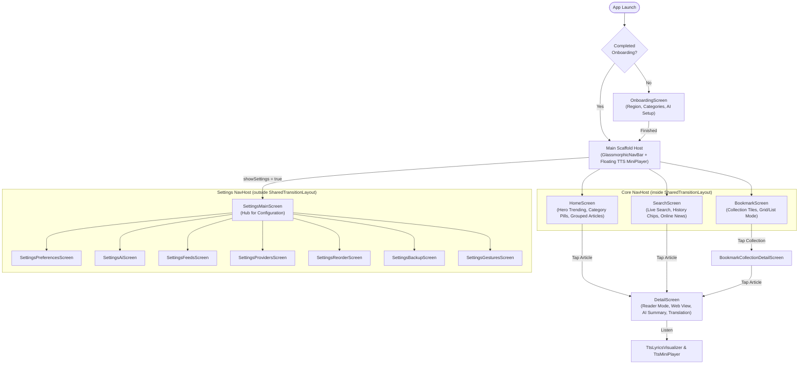

# 07 — Frontend & Android Client Architecture

> **Last verified commit:** `aaac96970daf81cd5d75cf5fa56dfebf2ecb6b48`  
> **Analysis Date:** 2026-08-25  
> **UI Toolkit:** Jetpack Compose (BOM `2025.05.00`), Material Design 3, Navigation Compose `2.8.2`

---

## 0. High Refresh Rate Handling

[MainActivity.kt](file:///d:/News/app/src/main/java/uk/sume/streamfolio/MainActivity.kt) calls `requestHighestRefreshRate()` in `onCreate()`, which sets `window.attributes.preferredDisplayModeId` to whichever `Display.Mode` has the highest `refreshRate`. Without this, some OEM display stacks auto-classify third-party app rendering into a refresh-rate category (Android's `FrameRateCategoryRate` mechanism) that maps to less than the display's peak rate even on a 120Hz-capable panel — verified via `adb shell dumpsys display` on a MediaTek device where `high` activity mapped to only 90Hz, capping this app there while system apps reached 120Hz. Setting the preferred display mode explicitly populates the `PRIORITY_APP_REQUEST_BASE_MODE_REFRESH_RATE` vote directly instead of leaving it to that per-device default guess (confirmed via the same `dumpsys` command: `mActiveModeId` moved from the 90Hz mode to the 120Hz one after this change).

---

## 1. Client App Architecture & Navigation Graph

StreamFolio's UI is built entirely using **declarative Jetpack Compose**, governed by Unidirectional Data Flow (UDF). Navigation is orchestrated by `AppNavigation` in [NavRoutes.kt](file:///d:/News/app/src/main/java/uk/sume/streamfolio/ui/navigation/NavRoutes.kt), which hosts **two independent `NavController`/`NavHost` pairs** behind a single `GlassmorphicNavBar`:

- A **core `NavHost`** (Onboarding, Home, Search, Bookmarks, `DetailScreen`, `BookmarkCollectionDetailScreen`) wrapped in `SharedTransitionLayout`, since these are the only screens that participate in a shared-element transition. Only the article **thumbnail image** is a `sharedElement` (it flies from its list/card position into the detail hero image); the **title is intentionally not** — interpolating a `Text` between very different font sizes/weights/families either reflows text every animation frame or pops visibly the instant the transition settles, so the title just fades in with the rest of the screen instead.
  - The list card (`ArticleListItem`, 256×256) and trending carousel (`TrendingCard`, 600×400) requests each set an explicit Coil `memoryCacheKey` of `"thumb_" + article.link`. `DetailScreen`'s hero image (which needs a larger decode to stay sharp at its bigger display size, so it can't just reuse the list's small request as-is) sets `placeholderMemoryCacheKey` to that same key plus `crossfade(true)`, so it paints instantly from whichever thumbnail bitmap is already cached instead of a blank flash, then crossfades to its own higher-resolution decode. All three requests also share the same custom `User-Agent` header (some publishers block the default OkHttp UA).
  - The app-wide default Coil `ImageLoader` (used by every `AsyncImage` that doesn't pass its own `imageLoader`) is supplied by [StreamFolioApplication.kt](file:///d:/News/app/src/main/java/uk/sume/streamfolio/StreamFolioApplication.kt) implementing `ImageLoaderFactory`, registered via `android:name=".StreamFolioApplication"` in `AndroidManifest.xml`. It sets `crossfade(true)` (so every image — favicons, thumbnails, everything — fades in instead of popping), a 25%-of-app-memory memory cache, a 100 MB disk cache, and the same custom `User-Agent` header as above applied globally via an OkHttp interceptor. `SettingsMainScreen`'s promo GIF still builds its own local `ImageLoader` (for GIF decoder support) and is unaffected by this default.
- A **Settings `NavHost`** (`SettingsMainScreen` + its 7 sub-pages) kept **outside** `SharedTransitionLayout`. Settings never uses a shared element, so isolating it avoids paying for `SharedTransitionLayout`'s lookahead layout pass while a Settings screen is active. A `showSettings` boolean (in `AppNavigation`) toggles which of the two hosts is visible; tapping the Settings tab does not use the core controller's `popUpTo`/`saveState` mechanism used for Home/Search/Bookmarks — it just flips `showSettings`, and the Settings `NavController`'s own back stack is preserved for free since the controller instance is hoisted above the toggle. System/gesture back while `showSettings` is true pops the Settings stack first, falling back to `showSettings = false` at its root. A deep-link from Home (e.g. the AI spotlight banner) into a specific settings sub-screen is queued as `pendingSettingsRoute` and consumed by a `LaunchedEffect` once the Settings `NavHost` has mounted and set its graph, since navigating that controller before it composes would crash.

---

## 2. Screen Specifications & Features

### 1. `HomeScreen` ([HomeScreen.kt](file:///d:/News/app/src/main/java/uk/sume/streamfolio/ui/screens/HomeScreen.kt))
- **Header & Branding:** StreamFolio brand typography with quick region selector modal.
- **Horizontal Category Pills:** Scrollable chip row displaying user-selected categories (`CategoryPill.kt`).
- **Hero Trending Card:** High-prominence card showcasing the lead story with image thumbnail and publisher badge.
- **Article Feed & Swipe Actions:** Rendered via `LazyColumn` using `SwipeableCard.kt` supporting left/right swipe gestures (customizable: bookmark, share, mark as read).
- **Story Grouping:** Multi-source coverage clustered into collapsible secondary stories (`groupSimilarStories`).
- **Feedback & States:** Pull-to-refresh, animated `SkeletonLoader.kt`, `OfflineIndicator.kt` banner, and Otter mascot empty states.

---

### 2. `DetailScreen` ([DetailScreen.kt](file:///d:/News/app/src/main/java/uk/sume/streamfolio/ui/screens/DetailScreen.kt))
- **Dual Reading Modes:**
  - **Clean Reader Mode:** Distraction-free text view rendered using Jsoup extracted HTML, customizable font family (`sans_serif`/`serif`), font size slider (12sp–30sp), and line height.
  - **Embedded Web Mode:** Full webview for rich media or interactive paywalled articles.
- **On-Device AI Summary:** Triggers Gemini Nano inference, displaying bulleted key takeaways in an interactive sheet.
- **ML Kit Translation:** Translates headline and body in real-time, displaying source and target language badges.
- **Audio Toolbar:** Immediate launch of TTS speech engine for current article text.
- **"Also Covered By" Panel:** Collapsible list of other sources reporting the same story, reusing the `groupId` already computed at ingest time (see [Flow 1](file:///d:/News/docs/01-architecture.md) in `01-architecture.md`) via a single indexed lookup — `NewsViewModel.loadSimilarArticles()` is deliberately deferred until the shared-element open animation finishes (`animatedVisibilityScope.transition.isRunning`), so it never competes with that transition.

---

### 3. `SearchScreen` ([SearchScreen.kt](file:///d:/News/app/src/main/java/uk/sume/streamfolio/ui/screens/SearchScreen.kt))
- **Search Bar:** Real-time query input with clear button and animated placeholder.
- **Recent Searches:** Horizontally scrollable chip row of previous queries (persisted up to 10 entries).
- **Hybrid Search Engine:**
  - Fast local Room database search (`LIKE %query%`).
  - Online Google News search query integration (`searchNewsOnline()`) fetching live web results.

---

### 4. `BookmarkScreen` & `BookmarkCollectionDetailScreen`
- **Multi-Collection Organization:** Displays default `"Saved"` collection alongside custom user-created lists.
- **Layout Switching:** Toggle between 2-column grid tiles (`CollectionGridCard`) and compact list rows (`CollectionListRow`).
- **Collection Management:** Create, rename, delete collections, with safe reassignment of articles into the default list upon deletion.
- **Naming:** the page header reads "Saved" (matching the `GlassmorphicNavBar` tab label and the default list's own name) — it previously said "Bookmarks", inconsistent with the rest of the save/collection terminology used everywhere else in the app.

---

### 5. Settings Modular Sub-Pages (`ui/screens/settings/`)

| Screen File | Configuration Scope |
| :--- | :--- |
| [SettingsMainScreen.kt](file:///d:/News/app/src/main/java/uk/sume/streamfolio/ui/screens/settings/SettingsMainScreen.kt) | Navigation hub, version info, quick cache statistics, GitHub links. |
| [SettingsPreferencesScreen.kt](file:///d:/News/app/src/main/java/uk/sume/streamfolio/ui/screens/settings/SettingsPreferencesScreen.kt) | Language, region, dynamic colors toggle, story grouping toggle. |
| [SettingsAiScreen.kt](file:///d:/News/app/src/main/java/uk/sume/streamfolio/ui/screens/settings/SettingsAiScreen.kt) | Master AI toggle, Gemini Nano AICore status check, translation & smart tags settings. |
| [SettingsFeedsScreen.kt](file:///d:/News/app/src/main/java/uk/sume/streamfolio/ui/screens/settings/SettingsFeedsScreen.kt) | Custom RSS feed additions, URL validation, OPML import and export. |
| [SettingsProvidersScreen.kt](file:///d:/News/app/src/main/java/uk/sume/streamfolio/ui/screens/settings/SettingsProvidersScreen.kt) | Enable/disable individual curated news publishers per category and cross-region. |
| [SettingsReorderScreen.kt](file:///d:/News/app/src/main/java/uk/sume/streamfolio/ui/screens/settings/SettingsReorderScreen.kt) | Drag-and-drop / arrow reordering of category tabs. |
| [SettingsBackupScreen.kt](file:///d:/News/app/src/main/java/uk/sume/streamfolio/ui/screens/settings/SettingsBackupScreen.kt) | Export application state to JSON, restore from JSON file with validation. |
| [SettingsGesturesScreen.kt](file:///d:/News/app/src/main/java/uk/sume/streamfolio/ui/screens/settings/SettingsGesturesScreen.kt) | Customize swipe-left and swipe-right card gesture actions. |

---

## 3. Core Shared UI Components

| Component | File Path | Architectural Responsibility |
| :--- | :--- | :--- |
| **`GlassmorphicNavBar`** | [GlassmorphicNavBar.kt](file:///d:/News/app/src/main/java/uk/sume/streamfolio/ui/components/GlassmorphicNavBar.kt) | Floating blurred navigation pill with icon morphing and active tab indicator. |
| **`TtsMiniPlayer`** | [TtsMiniPlayer.kt](file:///d:/News/app/src/main/java/uk/sume/streamfolio/ui/components/TtsMiniPlayer.kt) | Floating audio player bar with scrub progress, speed picker (0.5x–3.0x), and sleep timer. |
| **`TtsLyricsVisualizer`** | [TtsMiniPlayer.kt](file:///d:/News/app/src/main/java/uk/sume/streamfolio/ui/components/TtsMiniPlayer.kt#L550) | Full-screen Apple Music-style lyrics visualizer with real-time sentence/paragraph highlighting. |
| **`PublisherAvatar`** | [PublisherAvatar.kt](file:///d:/News/app/src/main/java/uk/sume/streamfolio/ui/components/PublisherAvatar.kt) | Publisher fallback badge rendering 2-letter initials with deterministic palette hashing. |
| **`BookmarkToastBanner`** | [BookmarkToastBanner.kt](file:///d:/News/app/src/main/java/uk/sume/streamfolio/ui/components/BookmarkToastBanner.kt) | Animated bottom banner with "Undo" action dispatching `ToastEvent`. |

---

## 4. Design System, Theming & Tokens

The application design system is defined in `ui/theme/` and mirrored in `design_system/`:

- **Primary Colors:** Cobalt Blue (`#1E88E5`), Navy Surface (`#0E1A33`), Deep Background (`#060D1E`), Cyan Accent (`#00B0FF`).
- **Container/outline tones:** [Theme.kt](file:///d:/News/app/src/main/java/uk/sume/streamfolio/ui/theme/Theme.kt)'s `darkColorScheme()`/`lightColorScheme()` calls explicitly set `primaryContainer`/`onPrimaryContainer`/`secondaryContainer`/`onSecondaryContainer`/`tertiaryContainer`/`onTertiaryContainer`/`outline`/`outlineVariant` (defined in [Color.kt](file:///d:/News/app/src/main/java/uk/sume/streamfolio/ui/theme/Color.kt)) in the same blue family as the rest of the brand palette. Compose Material3's `darkColorScheme()`/`lightColorScheme()` factories silently default any slot you don't pass to the stock M3 baseline **purple** palette — since these container/outline slots were never set, selected-row backgrounds (e.g. `SaveToListBottomSheet`'s checked list row, using `colorScheme.primaryContainer`) and various card borders across `BookmarkScreen` and the Settings screens rendered purple/gray instead of on-brand blue, verified visually against a real device before and after.
- **Dynamic Theming:** Supports Android 12+ Material You Dynamic Color extraction when `useDynamicColors` is toggled — note dynamic color derives its own full tonal palette from the device wallpaper and is unaffected by the container/outline fix above, which only applies to the static `DarkColorScheme`/`LightColorScheme`.
- **Typography:** Custom `Roboto Flex` / `Roboto Serif` scale spanning `display` (34sp), `brand` (28sp), `card-title` (16sp), down to `nano` (9sp).
- **Corner Radii:** Strict hierarchy — Chrome pills (32dp), Cards (20–24dp), Chips/Buttons (12–16dp), Micro badges (6–8dp).
