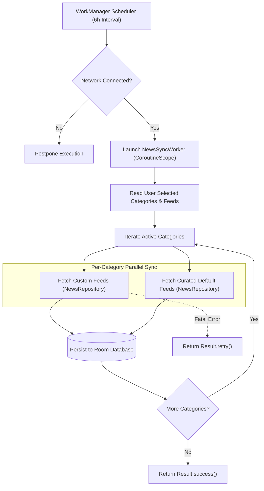

# 08 — Background Services & OS Integrations

> **Last verified commit:** `aaac96970daf81cd5d75cf5fa56dfebf2ecb6b48`  
> **Analysis Date:** 2026-08-25  
> **Backend Paradigm:** Zero-Cloud Architecture / Native Android OS Background Subsystems

---

## 1. Zero-Cloud Paradigm & Device Background Services

StreamFolio operates **without an external cloud backend, serverless functions, or remote database**. All background tasks, scheduled sync jobs, audio playback sessions, and widget providers execute natively on the Android host device through standard Android OS system services.

---

## 2. WorkManager Background Sync (`NewsSyncWorker`)

Defined in [NewsSyncWorker.kt](file:///d:/News/app/src/main/java/uk/sume/streamfolio/worker/NewsSyncWorker.kt).



### Worker Configuration & Lifecycle
- **Trigger Class:** [MainActivity.kt](file:///d:/News/app/src/main/java/uk/sume/streamfolio/MainActivity.kt#L44-L58) enqueues a periodic request:
  ```kotlin
  val syncRequest = PeriodicWorkRequestBuilder<NewsSyncWorker>(6, TimeUnit.HOURS)
      .setConstraints(Constraints.Builder().setRequiredNetworkType(NetworkType.CONNECTED).build())
      .build()

  WorkManager.getInstance(applicationContext).enqueueUniquePeriodicWork(
      "NewsBackgroundSync",
      ExistingPeriodicWorkPolicy.KEEP,
      syncRequest
  )
  ```
- **Execution Logic:**
  1. Instantiates `NewsRepository` and `PreferencesHelper`.
  2. Queries `customFeedDao().getAllFeedsSync()`.
  3. Iterates over `selectedCategories`, executing `fetchCustomFeeds()` and `fetchDefaultFeeds()` for each active category.
  4. Automatically prunes expired unbookmarked articles.
- **Resilience:** Uncaught network exceptions on individual categories are logged without killing the whole job; global failures trigger `Result.retry()` with exponential backoff.

---

## 3. MediaSession Foreground Service (`TtsPlaybackService`)

Defined in [TtsPlaybackService.kt](file:///d:/News/app/src/main/java/uk/sume/streamfolio/playback/TtsPlaybackService.kt).

### Architecture & Capabilities
- **Service Type:** Android `Service` declared in Manifest with `android:foregroundServiceType="mediaPlayback"` and `android:exported="false"`.
- **MediaSession Integration:** Manages a `MediaSessionCompat` instance named `"StreamFolioTts"`. Handles hardware media buttons (Bluetooth headsets, Android Auto, lockscreen media controls).
- **Transport Controls:** Supports `ACTION_PLAY`, `ACTION_PAUSE`, `ACTION_SKIP_TO_NEXT`, `ACTION_SKIP_TO_PREVIOUS`, and `ACTION_STOP`.
- **System Notification:**
  - Notification Channel: `tts_playback` (Low importance for silent media transport).
  - Uses `androidx.media.app.NotificationCompat.MediaStyle` displaying article title, publisher, cover artwork loaded via Coil, and active sleep timer countdown.

```kotlin
// MediaSession Callback Wiring
setCallback(object : MediaSessionCompat.Callback() {
    override fun onPlay() { playbackManager.resumePlayback() }
    override fun onPause() { playbackManager.pausePlayback() }
    override fun onSkipToNext() { playbackManager.advanceTtsPlaylist() }
    override fun onSkipToPrevious() { playbackManager.playPreviousArticle() }
    override fun onStop() {
        playbackManager.stopSpeakingPlaylist()
        stopForegroundCompat()
        stopSelf()
    }
})
```

---

## 4. AppWidget Service (`StreamFolioWidgetService`)

Defined in [StreamFolioWidgetService.kt](file:///d:/News/app/src/main/java/uk/sume/streamfolio/StreamFolioWidgetService.kt).

- **Service Permission:** Protected with `android.permission.BIND_REMOTEVIEWS`.
- **Role:** Returns a `RemoteViewsFactory` that queries `AppDatabase` on a background thread to generate RemoteViews list items for the home screen widget.
- **Data Binding:** Binds article headlines, publisher badges, and timestamp strings into `streamfolio_widget_item.xml`.
- **Interaction:** Employs `PendingIntent` template dispatching to `MainActivity` with `"article_url"` extra for seamless one-tap reading.
