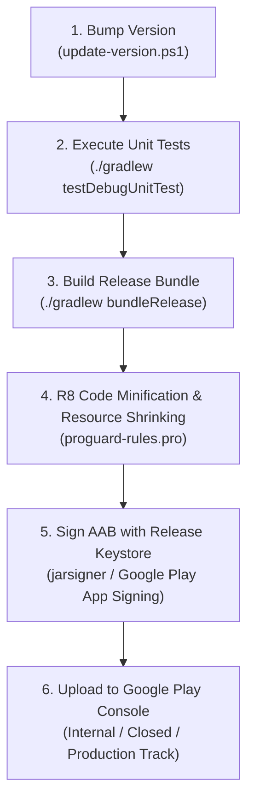

# 10 — CI/CD, Build & Release Engineering

> **Last verified commit:** `aaac96970daf81cd5d75cf5fa56dfebf2ecb6b48`  
> **Analysis Date:** 2026-08-25  
> **Release Artifact:** Android App Bundle (`.aab`) & Universal Signed APK (`.apk`)

---

## 1. Pipeline Status & External Infrastructure

> [!NOTE]
> **Status: Unknown / Externally Managed**  
> The repository does not currently contain committed CI/CD workflow definitions (e.g. `.github/workflows/` or `.gitlab-ci.yml`). Builds, version updates, and Google Play Store releases are executed locally via Gradle CLI and developer scripts.

---

## 2. Release Build & Packaging Workflow



### Step 1: Versioning Bump Utility
Execute the bundled PowerShell script to bump `versionCode` and `versionName`:

```powershell
# Working directory: d:/News
.\update-version.ps1
```

This updates:
- [app/build.gradle.kts](file:///d:/News/app/build.gradle.kts#L23-L24): `versionCode = <newCode>`, `versionName = "<newName>"`
- [SettingsMainScreen.kt](file:///d:/News/app/src/main/java/uk/sume/streamfolio/ui/screens/settings/SettingsMainScreen.kt#L230): UI version string

### Step 2: Build Release App Bundle (AAB)

```powershell
# Generate optimized Release App Bundle
./gradlew bundleRelease

# Output Artifact Location:
# app/build/outputs/bundle/release/app-release.aab
```

### Step 3: Build Release APK (For Direct Sideloading)

```powershell
# Generate Minified Release APK
./gradlew assembleRelease

# Output Artifact Location:
# app/build/outputs/apk/release/app-release-unsigned.apk
```

---

## 3. R8 Minification & Code Shrinking

Configured in [app/build.gradle.kts](file:///d:/News/app/build.gradle.kts#L29-L38):

```kotlin
buildTypes {
    release {
        isMinifyEnabled = true
        isShrinkResources = true
        proguardFiles(
            getDefaultProguardFile("proguard-android-optimize.txt"),
            "proguard-rules.pro"
        )
    }
}
```

- **Keep Rules ([proguard-rules.pro](file:///d:/News/app/proguard-rules.pro)):** Preserves Room database entities, DAOs, and ML Kit GenAI model reflection classes from obfuscation.

---

## 4. Baseline Profile Generation

> **Correction:** this section previously claimed a baseline profile was already shipped under `app/release/baselineProfiles/`; that directory exists but was empty — no profile was actually being generated or installed. The infrastructure below is what actually exists as of this doc's last verification, and has been run end-to-end against a physical device.

A **[`:baselineprofile`](file:///d:/News/baselineprofile/build.gradle.kts)** module (`com.android.test`, using the `androidx.baselineprofile` Gradle plugin) generates a real one. `:app` depends on it via `baselineProfile(project(":baselineprofile"))` and installs `androidx.profileinstaller` at runtime so ART actually uses the checked-in profile to precompile hot paths ahead-of-time instead of interpreting/JIT-warming them on first run — this is what "esp on load" perf work targets.

```powershell
# Runs against whatever device `adb devices` sees — a physical phone (USB debugging on) or a
# manually started emulator. No Gradle Managed Device / virtualization needed.
./gradlew :app:generateReleaseBaselineProfile

# Writes the human-readable profile to:
# app/src/release/generated/baselineProfiles/baseline-prof.txt
# Commit that file (it's real source, not build output — nothing in .gitignore excludes it)
# so release builds ship it.
```

Last generated against a CPH2651 (Android 16 / API 36) physical device: ~26,000 profile rule lines covering the app's cold-start path.

[`BaselineProfileGenerator.kt`](file:///d:/News/baselineprofile/src/main/java/uk/sume/streamfolio/baselineprofile/BaselineProfileGenerator.kt) currently profiles **cold app start only**. Extending it to also cover opening an article (the other perf-sensitive path worked on this session) needs a stable UiAutomator selector for the first list card — e.g. a `Modifier.testTag(...)` on `ArticleListItem` in [HomeScreen.kt](file:///d:/News/app/src/main/java/uk/sume/streamfolio/ui/screens/HomeScreen.kt), since there's currently nothing else to reliably target it from outside Compose.

---

## 5. App Signing Process (Play Store & Direct APK)

To sign an unsigned APK for testing or direct distribution:

```powershell
# 1. Align the APK
zipalign -v -p 4 app-release-unsigned.apk app-release-aligned.apk

# 2. Sign with release keystore using Android apksigner
apksigner sign --ks streamfolio-release.jks --ks-key-alias streamfolio --out app-release-signed.apk app-release-aligned.apk

# 3. Verify signing
apksigner verify app-release-signed.apk
```

---

## 6. Recommended GitHub Actions CI/CD Pipeline

To automate pull request validation and automated release builds, add the following workflow at `.github/workflows/android-ci.yml`:

```yaml
name: Android CI / CD

on:
  push:
    branches: [ main ]
    tags: [ 'v*' ]
  pull_request:
    branches: [ main ]

jobs:
  build-and-test:
    runs-on: ubuntu-latest
    steps:
      - name: Checkout Code
        uses: actions/checkout@v4

      - name: Set up JDK 17
        uses: actions/setup-java@v4
        with:
          distribution: 'temurin'
          java-version: '17'
          cache: 'gradle'

      - name: Grant Execute Permission to Gradlew
        run: chmod +x gradlew

      - name: Run Static Analysis & Lint
        run: ./gradlew lintDebug

      - name: Run Unit Tests
        run: ./gradlew testDebugUnitTest

      - name: Build Release Bundle
        run: ./gradlew bundleRelease
```
