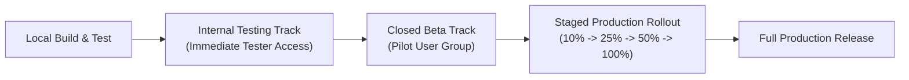

# 11 — Deployment, Operations & Distribution

> **Last verified commit:** `aaac96970daf81cd5d75cf5fa56dfebf2ecb6b48`  
> **Analysis Date:** 2026-08-25  
> **Package Identifier:** `uk.sume.streamfolio`

---

## 1. Distribution Channels

StreamFolio is distributed across three primary channels:

| Channel | Target Audience | Packaging Format | Delivery Mechanism |
| :--- | :--- | :--- | :--- |
| **Google Play Store** | General Public & End Users | Android App Bundle (`.aab`) | Google Play Console ([Store Link](https://play.google.com/store/apps/details?id=uk.sume.streamfolio)) |
| **GitHub Releases** | Power Users / Sideloading | Universal Signed APK (`.apk`) | GitHub Releases ([GitHub Repository](https://github.com/sm32d/streamfolio/releases)) |
| **Marketing Landing Site** | Prospective Users & Legal | Static Web Bundle (HTML/CSS/JS) | Web Host (e.g. GitHub Pages) from `landing/` directory |

---

## 2. Google Play Store Release Operations

### Release Track Strategy



1. **Internal Testing Track:** Used for validating signed bundles, verifying baseline profiles, and testing foreground service permissions (`FOREGROUND_SERVICE_MEDIA_PLAYBACK`).
2. **Staged Rollout (Recommended):** Deploy new versions to a 10% pilot audience to observe crash logs and bug reports before 100% distribution.

---

## 3. Rollback & Forward-Fix Strategy

### Mobile Binary Rollback Rules
- Google Play Store **does not allow rolling back to a lower `versionCode`**.
- Any critical regression or crash requires a **forward-fix patch**:
  1. Fix the bug on `main`.
  2. Increment `versionCode` using `./update-version.ps1` (e.g. `21` $\rightarrow$ `22`).
  3. Build and publish the patch bundle immediately.

### Database Schema Safety During Rollbacks
- If a user has updated their database to schema version `8` (`MIGRATION_7_8`), rolling back the app binary to a version supporting only schema `7` would cause a SQLite crash unless explicit fallback logic is in place.
- Therefore, all database migrations in [Migrations.kt](file:///d:/News/app/src/main/java/uk/sume/streamfolio/data/local/Migrations.kt) must maintain backward-compatible column defaults and non-breaking foreign keys.

---

## 4. Landing Page Operations (`landing/`)

The repository includes a self-contained marketing website in the `landing/` folder:

```
landing/
├── index.html              # Main marketing and feature showcase page
├── changelog.html          # Release history and release notes
├── privacy.html            # Privacy policy (100% on-device data guarantee)
├── terms.html              # Terms of service
├── index.css               # Dark/light themed styling system
└── app.js                  # Theme toggle & responsive mobile navbar scripts
```

### Static Hosting Guide
The `landing/` directory can be deployed directly to any static web host:
```powershell
# Example: Deploying to GitHub Pages or Netlify
# Point the document root to d:/News/landing
```

---

## 5. Link-Only Source Operations (Joho no Todai)

Source list file: [source-config/sources.json](file:///d:/News/source-config/sources.json), served to installed apps from `https://raw.githubusercontent.com/sm32d/streamfolio/master/source-config/sources.json` (the repository is public).

- **Enable:** set `"joho-todai-en": { "enabled": true }`, commit and push to `master`. Installed apps pick it up on their next refresh (the list is downloaded before every refresh; allow a few minutes for `raw.githubusercontent.com` caching). The file currently has it `true`.
- **Withdraw (publisher request):** set `enabled` to `false` (or remove the entry), commit and push. On each device's next refresh with a connection it stops fetching the feed and deletes the cached articles, bookmark-list associations and throttle state from that source. Keep the commit as the record of when withdrawal took effect, and notify the publisher.
- **Do not** rename the repository, the `master` branch or the file path without shipping an app update first; installs would stop seeing changes.
- **Before the first enable:** confirm with the publisher that the version of the app they were promised (link-only handling, 30-minute per-device limit, conditional requests, User-Agent, withdrawal) is the one released.
