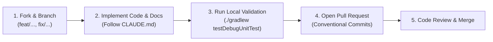

# 13 — Contributing & Engineering Standards

> **Last verified commit:** `aaac96970daf81cd5d75cf5fa56dfebf2ecb6b48`  
> **Analysis Date:** 2026-08-25

---

## 1. Development Workflow

We welcome contributions from open-source developers! Please follow this structured workflow:



### Branching Convention
- `feature/<feature-name>`: New capabilities or UI screens.
- `fix/<bug-description>`: Bug fixes or security hardening.
- `docs/<doc-topic>`: Documentation updates or corrections.
- `refactor/<subsystem>`: Structural refactoring without behavior change.

---

## 2. Commit Message Standards

Use [Conventional Commits](https://www.conventionalcommits.org/):

```
<type>(<scope>): <short summary>

[optional body explaining rationale and breaking changes]
```

**Allowed Types:**
- `feat`: New user-facing or developer feature.
- `fix`: Bug fix.
- `docs`: Documentation changes only.
- `style`: Formatting, missing semi-colons, whitespace.
- `refactor`: Code change that neither fixes a bug nor adds a feature.
- `test`: Adding or correcting tests.
- `chore`: Build scripts, dependencies, tooling updates.

*Example:* `feat(ai): add intelligent chunking for long articles in Gemini Nano preprocessor`

---

## 3. Pre-Commit / Pre-PR Validation Checklist

Before submitting a Pull Request, verify every item on this checklist:

- [ ] **Unit Tests:** `./gradlew testDebugUnitTest` runs and passes with zero failures.
- [ ] **Lint Analysis:** `./gradlew lintDebug` produces zero error-level issues.
- [ ] **Documentation Synchronization:** According to [CLAUDE.md](file:///d:/News/CLAUDE.md), any changes to database entities, UI routes, preferences, or network endpoints **must be documented in `/docs` within the same commit**.
- [ ] **Database Migration:** If altering `@Entity` classes, an explicit `Migration(N, N+1)` is written in [Migrations.kt](file:///d:/News/app/src/main/java/uk/sume/streamfolio/data/local/Migrations.kt), added to `ALL_MIGRATIONS`, and schema JSON is exported.
- [ ] **Security Review:** No unvalidated external URLs bypass `UrlSecurityValidator`. No secrets or credentials committed.
- [ ] **Design Tokens:** Reusable components consume unified tokens from `ui/components/` and `ui/theme/`.

---

## 4. Architecture Decision Record (ADR) Template

When introducing major architectural modifications, document the decision using the following ADR template under `docs/` or commit messages:

```markdown
# ADR-XXX: [Short Title of Architectural Decision]

## Status
[Proposed | Accepted | Superseded | Deprecated]

## Context & Problem Statement
[Describe the context, user need, and technical problem being solved.]

## Considered Options
1. [Option 1: Description]
2. [Option 2: Description]
3. [Option 3: Description]

## Decision Outcome
Chosen Option: [Option X], because [justification, trade-offs, and benefits].

## Consequences
- **Positive:** [What becomes easier or better]
- **Negative / Risks:** [What trade-offs or technical debt are introduced]

## Affected Components
- [List of files and classes affected]
```
